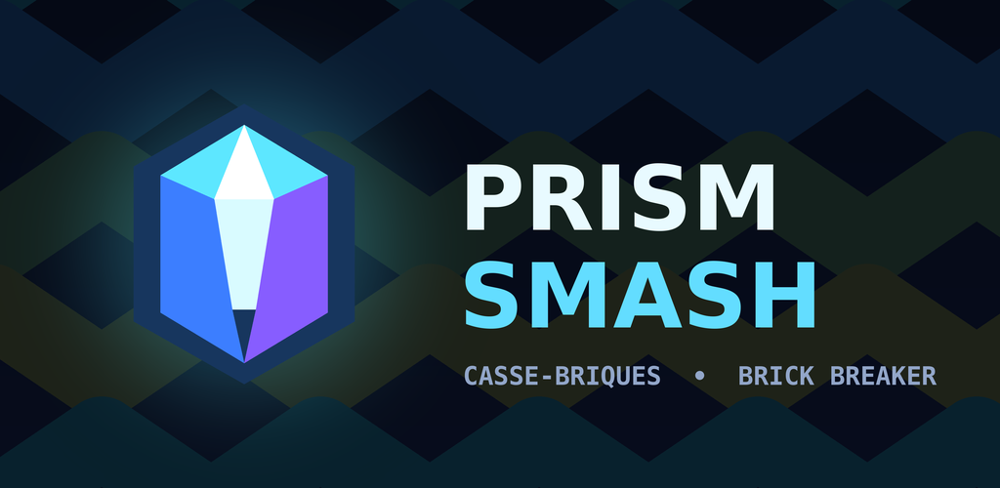
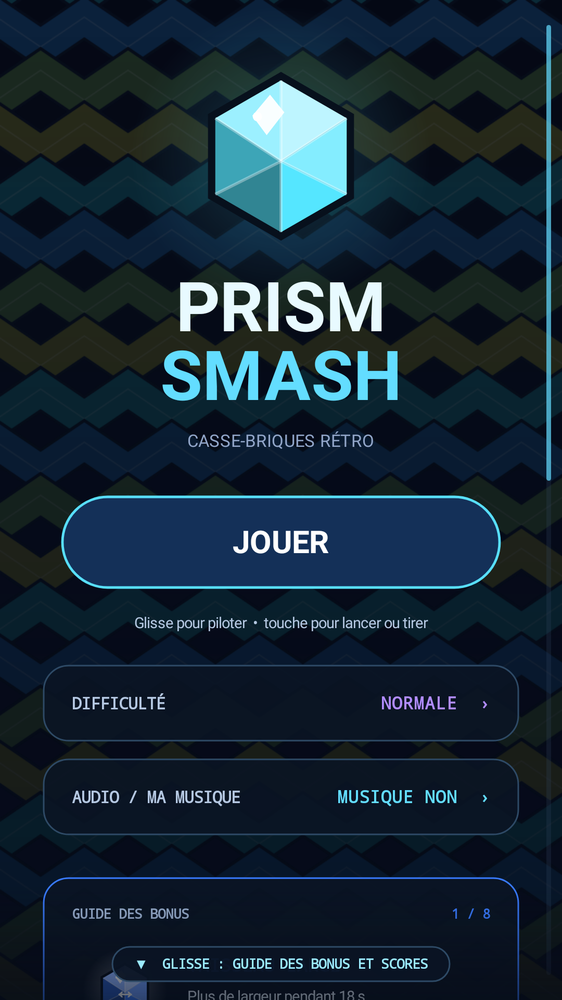
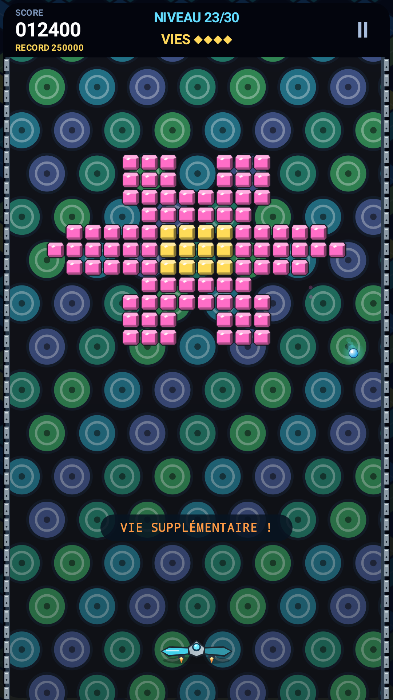
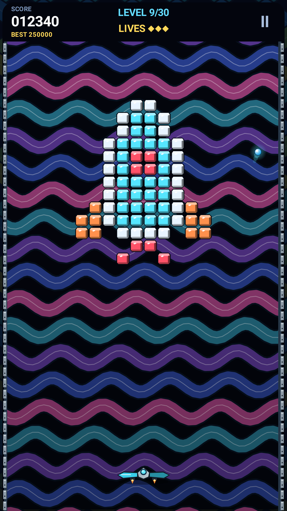

# Prism Smash

Casse-briques rétro pour Android : 30 tableaux de prismes à faire voler en éclats, 8 bonus, des vers à abattre ou à écraser, 3 difficultés et un top 20 pour chacune.

**[Télécharger la dernière version](https://github.com/Laurent-67370/prism-smash/releases/latest)** (`prism-smash.apk`, Android 6.0 ou plus récent).

  
  
  

- Pilotage au doigt (glissement, position directe ou zones), manette et clavier.
- Français et anglais.
- Sans publicité, sans achat intégré, sans compte, sans connexion Internet.
- [Politique de confidentialité](PRIVACY.md) : aucune donnée collectée.

---

Retro brick breaker for Android: 30 stages of prisms to shatter, 8 power-ups, worms to shoot or squash, 3 difficulty levels with a top 20 each. No ads, no account, no Internet connection, no data collected. **[Download the latest version](https://github.com/Laurent-67370/prism-smash/releases/latest)** · [Privacy policy](PRIVACY.md)
