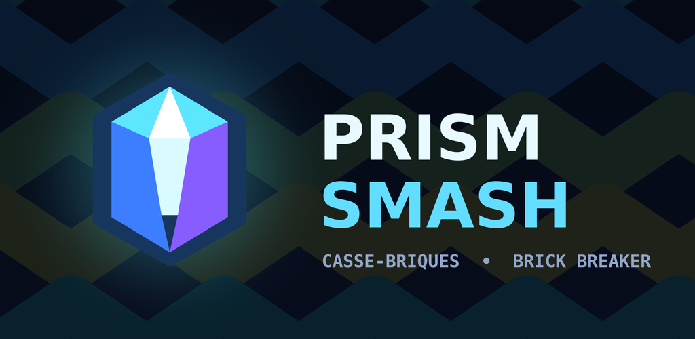
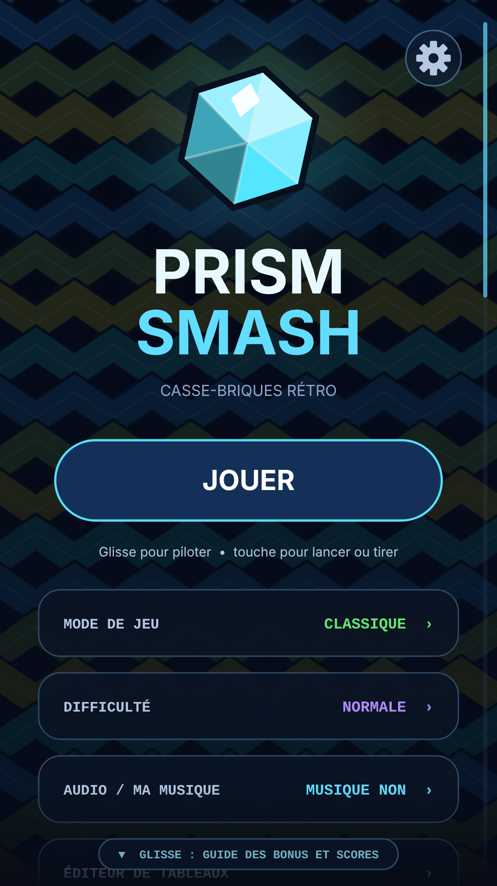
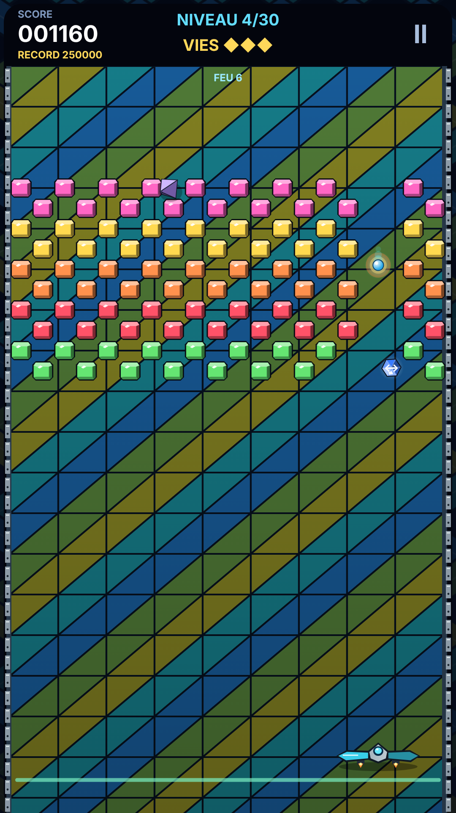
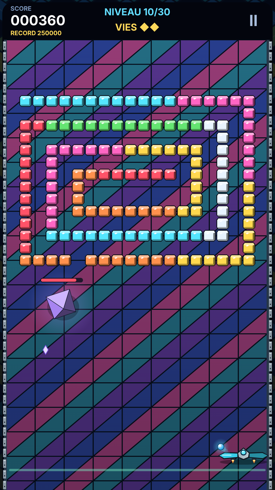
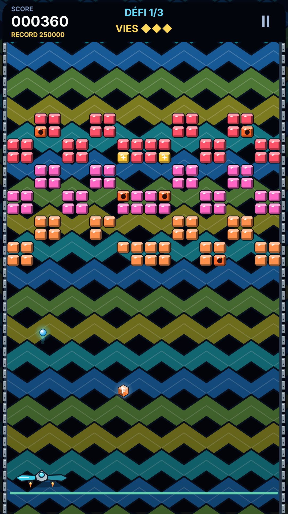
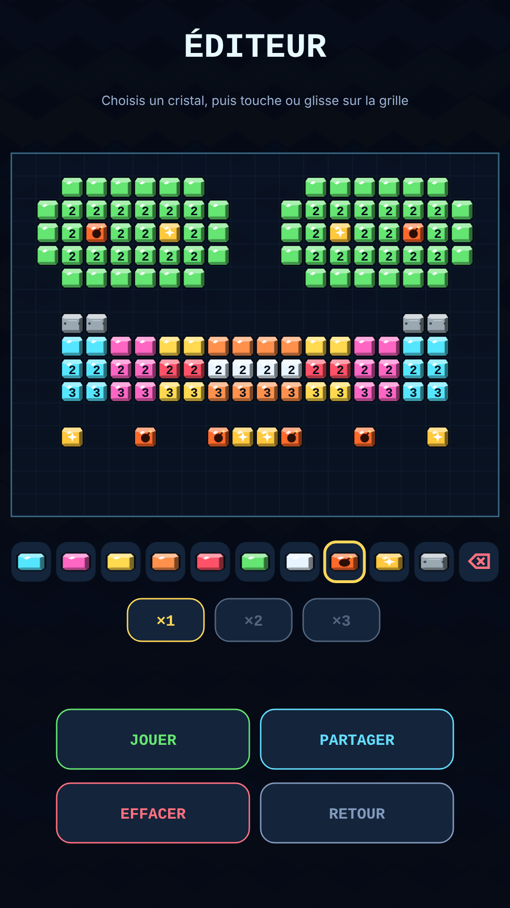
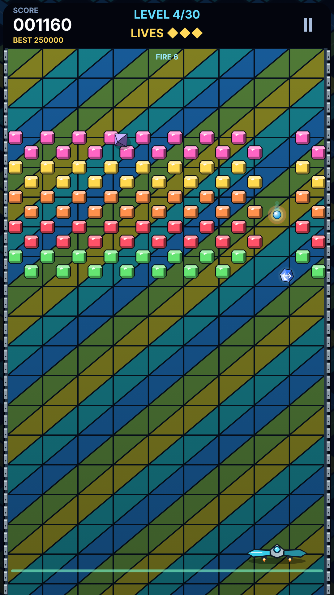

# Prism Smash

Casse-briques rétro pour Android, de style Amiga : 60 tableaux de prismes à faire voler en éclats, 4 modes de jeu, des boss, un Défi du jour et un éditeur de tableaux.

**[Télécharger la dernière version](https://github.com/Laurent-67370/prism-smash/releases/latest)** (`prism-smash.apk`, Android 6.0 ou plus récent). **[Jouer dans le navigateur](https://laurent-67370.github.io/crystal-hammer/)**, sans installation.

  
  
  
  
  

- **4 modes de jeu** : Classique (3 difficultés), Chrono, Survie et Défi du jour, chacun avec son top 20.
- **Un boss** tous les dix tableaux du mode Classique.
- **Défi du jour** : trois tableaux nouveaux chaque jour, les mêmes pour tout le monde, et une série de jours à entretenir 🔥.
- **Éditeur de tableaux** : dessinez votre mur, jouez-le et partagez-le par un lien.
- **10 bonus** (vaisseau large, balle lente, collante, multi-balles, laser, balle de feu, bouclier, vie, saut de tableau… et un malus), **cristaux explosifs et trésors**, vers et formes 3D à abattre ou à écraser.
- **14 succès** et partage du score.
- Musique originale de style Amiga (« Prism Drive »), ou votre propre musique, y compris les modules `.mod`.
- Pilotage au doigt (glissement, position directe ou zones), manette et clavier. Français et anglais.
- Sans publicité, sans achat intégré, sans compte, sans connexion Internet.
- [Politique de confidentialité](PRIVACY.md) : aucune donnée collectée.

---

Retro Amiga-style brick breaker for Android: 60 stages of prisms to shatter, 4 game modes (Classic, Time Attack, Survival, Daily Challenge), bosses, a stage editor with shareable links, 10 power-ups, explosive and treasure crystals, 14 achievements and an original Amiga-style soundtrack. No ads, no account, no Internet connection, no data collected.

**[Download the latest version](https://github.com/Laurent-67370/prism-smash/releases/latest)** · **[Play in your browser](https://laurent-67370.github.io/crystal-hammer/)** · [Privacy policy](PRIVACY.md)
